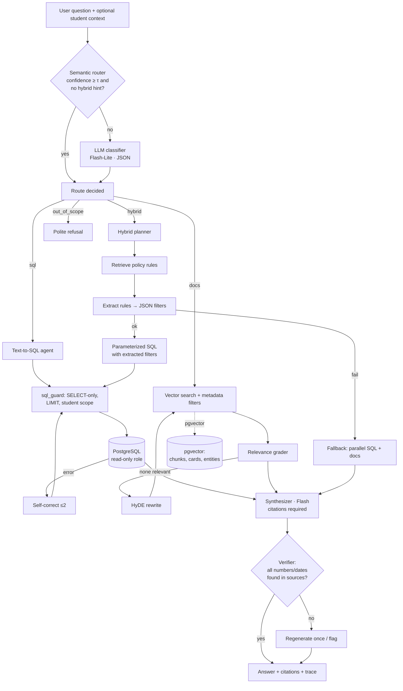
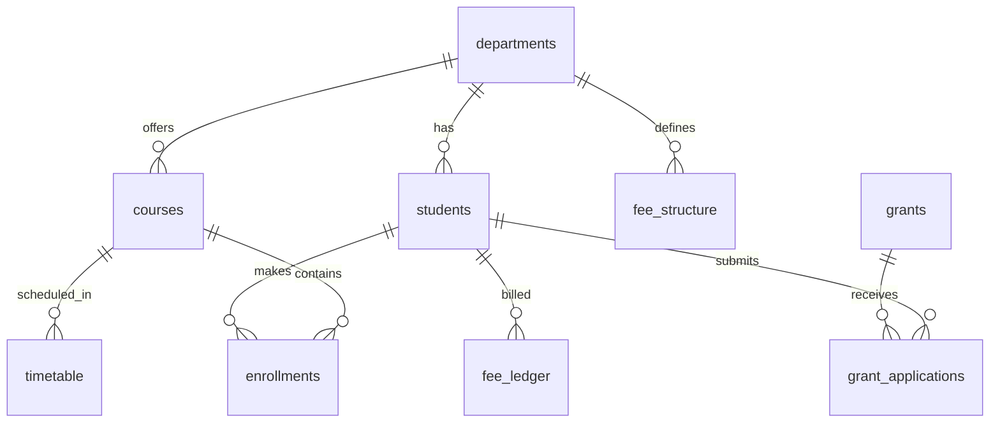

# UniRAG – Architecture & Design

**Unified Hybrid RAG for Structured and Unstructured University Intelligence**
Status: design frozen for implementation · 2026-11-23

---

## 0. Critical review of the initial design decisions

All ten decisions hold up. The changes below fix weak points and timeline risks, and are included in the final design.

| # | Decision | Risk / weakness | Change made |
|---|---|---|---|
| 1 | Eligibility rules only in documents | Without a shared key, the system can't reliably link a document rule to a database row | Every grant has a **`grant_code`** (e.g. `GR-AI-01`). It is the primary key's partner in SQL **and** is tagged in the metadata of each policy chunk. This shared key connects the two sources. |
| 2 | Live data never embedded | Row-to-text for grants (decision 3) seems to contradict this | Grant/course texts are embedded **for discovery only** (finding which entity is relevant). **All values** (amounts, deadlines, seats) in an answer come from SQL at question time. |
| 3 | Table cards | Cards drift from the real schema if written by hand | Cards are **generated from `information_schema` + sample values**, then a hand-written description is added. They are rebuilt on every ingest. |
| 4 | Two-stage router | Embedding similarity handles one intent well but is poor at spotting *mixed* intent (hybrid). A small set of examples makes it overconfident. | The semantic router takes the fast path **only** above a threshold calibrated on the evaluation set, and only for single-source routes. A "hybrid-hint" check (questions containing both eligibility/policy words and number/deadline words) always goes to the LLM classifier. |
| 5 | Hybrid planner that tracks dependencies | Turning free-text rules into SQL filters is the most fragile step | Rules are extracted into a **fixed JSON filter schema** (`{field, op, value, source_chunk}`), never free-form SQL. If extraction fails, it falls back to **parallel retrieval + LLM merge**, so the system still answers, with lower precision. |
| 6 | SQL safety + HyDE | HyDE and relevance grading add 2–3 LLM calls per question, which is latency and rate-limit risk on the Gemini free tier | Grading uses the cheaper Flash-Lite model in **one batched call**. HyDE runs **only** when grading finds no relevant chunk. All LLM calls go through a cached client with retry/backoff. HyDE is the first feature to cut if we fall behind. |
| 7 | Number verification | Simple string matching fails on `₹1,20,000` vs `120000`, or `15 Dec 2026` vs `2026-12-15` | Values are normalized first (strip currency symbols and Indian/Western digit grouping, parse dates to ISO) before checking. Any number that can't be verified is **flagged in the trace**, not silently dropped. |
| 8 | Streamlit trace | — | Add a **"Logged in as" student selector**. It enables personal questions ("what is *my* pending fee?") and shows **row-level access**: SQL for personal questions is automatically scoped to `student_id`. This is a strong enterprise talking point. |
| 9 | Evaluation | 40 questions × ~5 LLM calls could hit free-tier limits | Eval runner is throttled and resumable, results cached per question. The vector-only baseline shares the same cache. |
| 10 | MCP | — | Kept as stretch. It reuses the same `query_db` / `search_docs` functions, so it takes ≈45 min if there is time. |

**Additional risks for the timeline**
- **LangGraph learning curve** → keep the graph to 8 nodes or fewer, with typed state (one `TypedDict`).
- **Windows + Docker** → Postgres on port `5433` to avoid a clash with any local install. pgvector image `pgvector/pgvector:pg16`.
- **Out-of-scope questions** → an explicit `out_of_scope` route that politely refuses. It counts in the evaluation.
- **Model names change often** → model IDs live in `.env`, not in code.

---

## (a) Final architecture

### Component responsibilities

| Layer | Component | Responsibility |
|---|---|---|
| **Ingestion** (offline) | `load_sql` | Create schema, seed tables from CSV, create read-only role `unirag_reader` |
| | `chunk_docs` | Split policy docs by heading (≈500 tokens, 60 overlap), attach metadata: `doc_type, department, year_applicability, effective_date, grant_codes[]` |
| | `schema_cards` | Build one card per table from `information_schema`, sample values, foreign keys and a description |
| | `entity_text` | Row-to-text for `grants` and `courses` (discovery index) |
| | `embed` | Gemini embeddings (768-dim) → pgvector, HNSW index |
| **Routing** | `semantic_router` | Cosine similarity against ~60 labelled example questions → route + confidence (no LLM call) |
| | `llm_classifier` | Gemini Flash-Lite, JSON output: `route, sub_questions[], entities{dept, year, cgpa, grant_code…}, needs_personal_scope` |
| **Retrieval** | `sql_agent` | Schema-card retrieval → Gemini text-to-SQL → `sql_guard` → execute (read-only, timeout 5 s, LIMIT 200) → retry on error ×2 |
| | `sql_guard` | sqlglot parse: one statement, SELECT only, allow-listed tables, inject `LIMIT`, inject `student_id` scope for personal questions |
| | `vector_search` | pgvector cosine + metadata filters (department, doc_type, grant_code) + keyword boost (hybrid search) |
| | `grader` / `hyde` | Batched relevance grading; HyDE rewrite + re-search if nothing relevant |
| **Orchestration** | `hybrid_planner` | Docs → extract rules (JSON filters) → parameterized SQL → merge. Fallback: run both in parallel and merge. |
| | `graph` (LangGraph) | State machine connecting all nodes; records a trace event per node |
| **Synthesis** | `synthesizer` | Gemini Flash; SQL rows as a markdown table + numbered chunks; must cite `[SQL]` / `[Doc: title §section]`; keeps tables and dates exact |
| | `verifier` | Normalize and check every number/date in the answer against the sources; flag or regenerate once |
| **Interface** | Streamlit app | Chat, student selector, trace panel (route + confidence, SQL, rows, chunks, verification, latency per node) |
| | MCP server (stretch) | `query_db`, `search_docs`, `ask_unirag` tools |

### Request flow



### Worked example – the problem statement's question
> *"I am a third-year CS student with a 3.8 GPA; what research grants am I eligible for, and what is the deadline to apply?"*

1. Router: hybrid hint (eligibility + deadline) → LLM classifier → `hybrid`, entities `{dept: CS, year: 3, cgpa: 3.8}`.
2. Planner retrieves chunks from *Research Grant Policy* (filter `doc_type=grant_policy`) → extracts per-grant rules, e.g. `GR-AI-01: min_cgpa 3.5, years [3,4], depts [CS, IT]`.
3. Grants whose rules match the student's profile → `grant_code IN (...)` → SQL: `SELECT title, amount, application_deadline FROM grants WHERE grant_code IN (...) AND status='open'`.
4. Synthesizer combines the rules (with doc citations) and the live amounts and deadlines (with [SQL] citations) into a table. The verifier confirms every amount and date came from the rows.

---

### Implementation notes (Phase 3b)
- **One "understand" call** does stage-2 routing, entity extraction, passage relevance, rule extraction and the database task together. This keeps a hybrid question at 3 generation requests: understand → SQL → synthesis.
- **Entities and profile** come from regex plus the student record in the database, with no LLM. A 4-point GPA is converted with the Handbook §4 factor.
- **Grant questions fetch every grant chunk that passes the department and year metadata filters,** with no top-k cut-off. The rule engine then checks CGPA. This fixed a recall bug where top-k dropped eligible grants.
- **The rule engine runs in code.** Extracted conditions are checked against the profile. For grant eligibility the database query is then **compiled in code** from the result (parameterised, no LLM), so a grant question needs 2 generation requests. Other hybrid questions pass the rule results as constraints to text-to-SQL.
- **Arithmetic** (balances, day counts, fines) is pushed into SQL. Synthesis copies values; it doesn't calculate.
- **The verifier** extracts every figure in the answer and accepts only evidence values or narrow derivations: row differences and sums, stated percentages, GPA conversion, and day counts × stated ₹ rates.

## (b) Database schema

### Relational (structured)



| Table | Key columns |
|---|---|
| `departments` | `dept_id PK`, `code` (CS/IT/ENTC), `name`, `hod_name` |
| `students` | `student_id PK` (e.g. `S2023CS014`), `full_name`, `dept_id FK`, `year_of_study` (1–4), `cgpa` (0–10 scale **and** a `gpa_4` column for 4-point questions), `admission_year`, `is_hosteller`, `email` |
| `courses` | `course_id PK`, `course_code`, `title`, `dept_id FK`, `semester`, `credits`, `capacity`, `instructor` |
| `enrollments` | `enrollment_id PK`, `student_id FK`, `course_id FK`, `term` (e.g. `2026-ODD`), `status` (enrolled/dropped), `attendance_pct`, `grade` |
| `timetable` | `slot_id PK`, `course_id FK`, `day_of_week`, `start_time`, `end_time`, `room`, `term` |
| `fee_structure` | `dept_id FK`, `year_of_study`, `component` (tuition/exam/hostel/lab), `amount`, `academic_year` |
| `fee_ledger` | `txn_id PK`, `student_id FK`, `academic_year`, `component`, `amount_due`, `amount_paid`, `due_date`, `paid_on`, `status` (paid/partial/pending/overdue) |
| `grants` | `grant_id PK`, **`grant_code` UNIQUE** (cross-source join key), `title`, `sponsor`, `amount`, `max_awards`, `application_open`, `application_deadline`, `status`, `policy_doc` |
| `grant_applications` | `application_id PK`, `grant_id FK`, `student_id FK`, `submitted_on`, `status` |

Note: `grants` holds **no eligibility columns**. Eligibility exists only in the policy text, by design.

### Vector side (pgvector, same database)

| Table | Columns |
|---|---|
| `doc_chunks` | `chunk_id`, `doc_id`, `doc_title`, `section`, `content`, `embedding vector(768)`, `doc_type`, `department`, `year_applicability int[]`, `effective_date`, `grant_codes text[]`, `metadata jsonb` |
| `schema_cards` | `table_name`, `card_text`, `embedding vector(768)` |
| `entity_texts` | `entity_type` (grant/course), `entity_key`, `text`, `embedding vector(768)` |
| `router_exemplars` | `exemplar_id`, `question`, `route`, `embedding vector(768)` |

Indexes: HNSW (`vector_cosine_ops`) on every embedding column; GIN on `grant_codes` and `metadata`.

### Policy documents (unstructured, 7)
1. Student Handbook (general rules, academic calendar)
2. Research Grant Policy (eligibility, documents, selection per `grant_code`)
3. Fee Payment & Refund Policy (late fines, instalments, refunds)
4. Scholarship & Fee Concession Policy
5. Examination & Attendance Rules
6. Hostel Rules & Allotment Policy
7. Course Registration & Credit Policy

---

## (c) Repository structure

```
UniRAG/
├── docker-compose.yml          # postgres + pgvector (port 5433)
├── .env.example                # GEMINI_API_KEY, model IDs, DB URLs
├── requirements.txt
├── README.md                   # setup + run in 5 commands
├── prompts.md                  # prompt engineering log (submission)
├── docs/
│   └── architecture.md
├── db/
│   └── init/                   # 01_extensions.sql, 02_schema.sql, 03_roles.sql
├── data/
│   ├── seed/                   # generated CSVs
│   └── docs/                   # 7 policy documents (.md)
├── scripts/
│   ├── generate_data.py        # synthetic data (fixed seed → reproducible)
│   └── ingest.py               # one command: seed SQL + chunk + embed
├── src/unirag/
│   ├── config.py
│   ├── llm.py                  # Gemini client, retry/backoff, disk cache
│   ├── db.py
│   ├── ingest/                 # chunk_docs, schema_cards, entity_text, embed
│   ├── router/                 # semantic.py, classifier.py
│   ├── retrieval/              # sql_agent.py, sql_guard.py, vector_search.py, grader.py, hyde.py
│   ├── planner/                # graph.py (LangGraph), hybrid.py
│   ├── synthesis/              # synthesizer.py, verifier.py
│   └── prompts/                # router.md, sql.md, rules.md, synth.md (versioned)
├── app/
│   └── streamlit_app.py
├── eval/
│   ├── questions.jsonl         # labelled questions
│   ├── run_eval.py
│   ├── baseline_vector_only.py
│   └── results/
├── mcp_server/
│   └── server.py               # stretch
└── tests/
```

---

## (d) Build order & time estimates

| # | Module | Output | Est. | Cut if late? |
|---|---|---|---|---|
| 1 | Infra | docker-compose, schema SQL, read-only role, `.env` | 0.5 h | – |
| 2 | Synthetic data | `generate_data.py`, CSVs, 7 policy docs consistent with the grant codes | 1.25 h | – |
| 3 | LLM client + ingestion | `llm.py`, chunking with metadata, schema cards, entity texts, embeddings | 1.25 h | – |
| 4 | SQL agent | card retrieval, text-to-SQL, `sql_guard`, retry | 1.25 h | – |
| 5 | Vector retrieval | filtered search, keyword boost, grader (+HyDE) | 0.75 h | HyDE |
| 6 | Router | exemplars, semantic router, LLM classifier, threshold | 1.0 h | – |
| 7 | Hybrid planner + graph | rule extraction → filters → SQL, fallback, LangGraph wiring, trace | 1.5 h | – |
| 8 | Synthesis + verifier | citation prompt, normalization, check | 1.0 h | regenerate step |
| 9 | Streamlit UI | chat, student selector, trace panel | 1.0 h | – |
| 10 | Evaluation | questions, runner, baseline, charts | 1.0 h | – |
| 11 | MCP server | 3 tools over existing functions | 0.75 h | **yes** |
| | **Core total** | | **≈10.5 h** | |

Order of what to cut if behind schedule: MCP → HyDE → verifier regeneration (keep flagging) → keyword boost.

---

## (e) Gemini models

**Revised 23 Nov after testing on the free tier** (see prompt log P-004/P-005). The free tier allowed only 5 requests per minute and 20 per day for the Flash models. `gemini-3.8-flash` was overloaded (503), 3.7/3.5 Flash timed out, and the 2.5 models are closed to new users.

| Use | Model ID | Reason |
|---|---|---|
| All generation steps: classification, rule extraction, text-to-SQL, synthesis | `gemini-3.1-flash-lite` | Available on the free tier and the fastest model on our key (1.5 s in testing). JSON-schema output keeps its answers well-formed. |
| Backup when the primary is overloaded or out of quota | `gemini-3.5-flash-lite` → `gemini-3.6-flash` | Automatic fallback chain. 3.6 Flash is kept last because of its 20-per-day limit. |
| Embeddings (chunks, cards, entities, router examples) | `gemini-embedding-001`, `output_dimensionality=768` | Text-only model with a generous free-tier limit. 768 dimensions keep the pgvector HNSW indexes small and fast (pgvector's HNSW limit is 2,000 dimensions). |

**Call budget:**
- The first-stage router and all retrieval use embeddings only, with no generation call.
- A hybrid question costs at most about 3 generation calls.
- Calls are paced per model to stay under the per-minute limit.
- Every response is cached on disk, so evaluation reruns are free.

All model IDs and limits live in `.env` (`GEN_MODEL`, `FAST_MODEL`, `*_FALLBACKS`, `MODEL_RPM`). Moving to a paid tier needs no code change.
